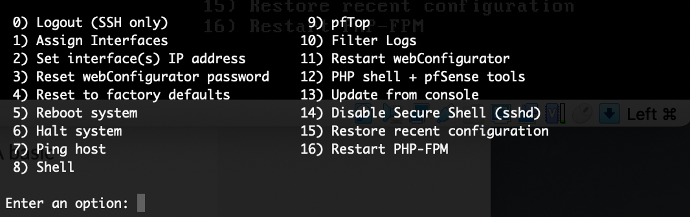
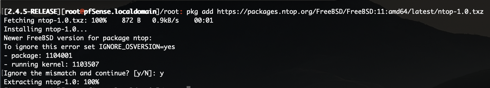

<a id="pfsenseintegration"></a>

# pfsense {#pfsense}

nProbe can be installed on pfsense using the command line.
This requires the configuration of the FreeBSD repository as
described at <https://packages.ntop.org/FreeBSD/>.

## Repository Configuration {#repository-configuration}

Log into the pfsense Shell as administrator (select option 8).



And install the repository using the command provided at <https://packages.ntop.org/FreeBSD/>
(you can cut&paste the command below).

```bash
pkg add https://packages.ntop.org/FreeBSD/FreeBSD:11:amd64/latest/ntop-1.0.txz
```

The output should look like the below.



## Package Installation {#package-installation}

After logging into the pfsense Shell, run the below command to install
the nProbe package:

```bash
pkg install nprobe
```

## License Configuration {#license-configuration}

Run the below command in order to get all the information required
by the license generator (*Version* and *System ID*).

```bash
/usr/local/bin/nprobe --version
```

The license should be installed under /usr/local/etc/nprobe.license

```bash
echo LICENSE_KEY > /usr/local/etc/nprobe.license
```

## nProbe Configuration {#nprobe-configuration}

A sample nProbe configuration file is located under /usr/local/etc/nprobe/nprobe.conf.sample,
please copy it to /usr/local/etc/nprobe.conf and open it with the preferred editor in case
the default settings should be modified.

Enable nProbe with the below commands:

```bash
sysrc nprobe_enable="YES"
```

Run the nProbe service:

```bash
service nprobe start
```
